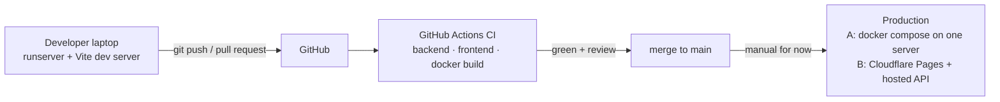
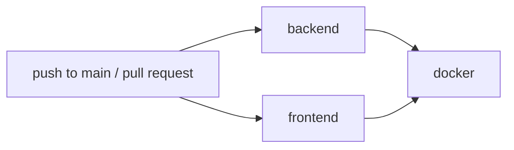

# Deployment, Docker & CI

How the code gets from a laptop to production: environments, Docker images, the production stack, the CI
pipeline and (not yet automated) deployment. Target: a small, cheap setup for the project demo on a real domain,
e.g. `onlywheels.ro`.

> **Status:** the Docker images, the production compose file and the CI workflow are written but **were never
> executed** (no Docker or GitHub runner was available while building the project). Expect small fixes on the
> first run. Deployment itself is manual (§7).

## 0. How it fits together



| | Development | CI (GitHub Actions) | Production |
|---|---|---|---|
| Django settings | `config.settings.dev` (default of `manage.py`) | `config.settings.test` for pytest, `dev` for the manage.py checks | `config.settings.prod` |
| Database | PostgreSQL (native, `infra/docker-compose.yml` or Supabase) | PostgreSQL 16 service container | `postgres` container (A) or managed PostgreSQL (B) |
| Celery | Eager (tasks run inline, no Redis) | Eager | Redis + `worker` + `beat` |
| Email | Printed to the console | In memory (tests) | Resend via django-anymail |
| Payments | `fake` (simulated) | `fake` (tests) | `stripe` (`fake` is refused) |
| Uploads | `backend/media/` | In memory (tests) | `media` volume (A) or Cloudflare R2 |
| Frontend | Vite dev server :5173, proxies `/api` and `/media` | `pnpm build` | nginx image (A) or Cloudflare Pages (B) |
| Logs | Readable console lines | — | JSON lines |
| CSP header | Off (on in tests) | On (tests) | On |

All differences are environment variables; the code is the same everywhere ([SETUP.md §9](SETUP.md)).

Two production options are prepared; pick one:

| | Option A – one server with Docker | Option B – managed services |
|---|---|---|
| Frontend | nginx container (same domain) | Cloudflare Pages |
| API | gunicorn container | Render / Railway / VPS (same API image) |
| Database | PostgreSQL container (or managed) | Managed PostgreSQL (Supabase, Neon…) |
| Jobs | Redis + Celery worker + beat containers | Provider's Redis + worker/cron |
| Effort | One `docker compose up`; you run backups and updates | More dashboards, less server work |
| Files | `infra/docker-compose.prod.yml`, `infra/docker/`, `infra/nginx/` | `frontend/public/_headers`, `_redirects` |

## 1. Domain and DNS (both options)

1. Buy the domain (ROTLD registrar for `.ro`), set the nameservers to Cloudflare.
2. Option A: `onlywheels.ro` (and `www`) → server IP, proxied (orange cloud).
   Option B: `onlywheels.ro` → Cloudflare Pages project, `api` → API host.
3. SSL/TLS mode **Full (strict)** (Cloudflare Origin Certificate on the server) and "Always use HTTPS".

## 2. Docker images

| Image | Dockerfile | Build context | Contents |
|---|---|---|---|
| `onlywheels-api` | `infra/docker/backend.Dockerfile` | `backend/` | `python:3.12-slim` + uv; dependencies in `/opt/venv` (from `uv.lock` when committed); code in `/app`; **static files collected at build time** (WhiteNoise); runs as non-root user `app` (uid 1000); port 8000; default command gunicorn (3 workers, WSGI) |
| nginx image | `infra/docker/frontend.Dockerfile` | repository root | Stage 1 `node:22-alpine`: `pnpm install` + `pnpm build`. Stage 2 `nginx:1.27-alpine`: the `dist/` build + `infra/nginx/default.conf`; port 80 |

- The same API image runs as `web`, `worker` and `beat`; only the command differs.
- Build arguments of the nginx image (`VITE_API_URL`, `VITE_GOOGLE_CLIENT_ID`, `VITE_SENTRY_DSN`) are baked into
  the JavaScript bundle – **public values only**, never secrets. Changing them needs a rebuild.
- `.dockerignore` (root) and `backend/.dockerignore` keep `.env` files, `node_modules`, `.venv`, `media/`,
  `staticfiles/` and `docs/` out of the images.
- Build one image by hand: `docker build -f infra/docker/backend.Dockerfile backend` (from the repository root).

## 3. Option A – production stack with Docker Compose

```
Cloudflare (TLS) ──► nginx :80 ─┬─ /                     React build (SPA, service worker)
                                ├─ /api/ /admin/ /static/ ──► web (gunicorn + Django + WhiteNoise) :8000
                                └─ /media/               ◄── shared "media" volume (unless R2 is used)
                     worker (Celery) ─┐
                     beat (Celery)  ──┴──► redis ;  web/worker/beat ──► postgres (volume "postgres-data")
```

### 3.1 Services (`infra/docker-compose.prod.yml`)

| Service | Image | Command | Published port | Volumes | Notes |
|---|---|---|---|---|---|
| `postgres` | `postgres:16-alpine` | default | none | `postgres-data` | Health check `pg_isready`; the backend services wait for it |
| `redis` | `redis:7-alpine` | default | none | — | Celery broker (db 0) + Django cache (db 1); no persistence needed |
| `web` | `onlywheels-api` | `migrate`, then gunicorn | none | `media` | Migrations run on every start |
| `worker` | `onlywheels-api` | `celery -A config worker` | none | `media` | Emails, order expiry tasks |
| `beat` | `onlywheels-api` | `celery -A config beat` | none | — | Schedules `expire_unpaid_orders_task` every 5 min; **run exactly one** |
| `nginx` | built from `frontend.Dockerfile` | default | `${HTTP_PORT:-80}` | `media` (read-only) | The only service reachable from outside |

All services restart automatically (`unless-stopped`). Only nginx is exposed; PostgreSQL and Redis are reachable
only inside the compose network.

### 3.2 Configuration

- `infra/.env.prod` (copied from `infra/.env.prod.example`, **never committed**) is used twice:
  `--env-file` fills `${…}` in the compose file (`POSTGRES_PASSWORD`, `HTTP_PORT`, `VITE_*`), and
  `env_file:` passes everything to the backend containers.
- The compose file sets `DJANGO_SETTINGS_MODULE`, `DATABASE_URL`, `CELERY_BROKER_URL`, `CACHE_URL` and
  `CELERY_TASK_ALWAYS_EAGER` itself; these win over the same names in `.env.prod`.
- Use only letters and digits in `POSTGRES_PASSWORD` – it is put into a URL.

### 3.3 First deployment

On a VPS (Ubuntu with Docker Engine + compose plugin):

```bash
git clone <repo> onlywheels && cd onlywheels
cp infra/.env.prod.example infra/.env.prod          # fill in every value
alias dc='docker compose -f infra/docker-compose.prod.yml --env-file infra/.env.prod'
dc up -d --build
dc exec web python manage.py createsuperuser
dc exec web python manage.py seed_demo              # demo data only
```

- Same origin for SPA and API → no CORS, `VITE_API_URL` stays empty, cookies are first-party.
- TLS ends at Cloudflare; nginx forwards `X-Forwarded-Proto`, so Django's HTTPS redirect does not loop.
  Without Cloudflare, put Caddy or Traefik in front for certificates.

### 3.4 Operations

| Task | Command (`dc` = alias above) |
|---|---|
| Status | `dc ps` |
| Logs (JSON lines) | `dc logs -f web worker` |
| Update to the latest `main` | `git pull && dc up -d --build` (migrations run automatically) |
| Django command | `dc exec web python manage.py <command>` |
| More workers | `dc up -d --scale worker=2` (never scale `beat`) |
| Backup | `dc exec -T postgres pg_dump -U onlywheels onlywheels > backup-$(date +%F).sql` (daily cron, copy off the server) |
| Restore | `dc exec -T postgres psql -U onlywheels onlywheels < backup.sql` (into an empty database) |
| Stop | `dc down` – **`dc down -v` also deletes the database and media volumes** |

### 3.5 Trying the production stack locally

Possible on any machine with Docker; useful before the first real deployment. In `infra/.env.prod`:

```
POSTGRES_PASSWORD=localtest
DJANGO_SECRET_KEY=<any 50+ character string>
DJANGO_ALLOWED_HOSTS=localhost
FRONTEND_URL=http://localhost:8080
CORS_ALLOWED_ORIGINS=http://localhost:8080
CSRF_TRUSTED_ORIGINS=http://localhost:8080
DJANGO_SECURE_SSL_REDIRECT=False                       # no TLS locally
EMAIL_BACKEND=django.core.mail.backends.console.EmailBackend   # emails in `dc logs worker`
HTTP_PORT=8080
```

Then `dc up -d --build` and open **http://localhost:8080** (use `localhost`: browsers accept the API's Secure
cookies only there without HTTPS). `PAYMENT_PROVIDER` must stay `stripe` in production settings; without Stripe
test keys everything works except the payment step.

## 4. Option B – Cloudflare Pages + hosted API

```
onlywheels.ro      → Cloudflare Pages      (frontend: static build of `frontend/`)
api.onlywheels.ro  → Render/Railway or VPS (Django + gunicorn, same API image as option A)
                     ├── PostgreSQL (managed)
                     ├── Redis + Celery worker + Celery Beat
                     └── media → Cloudflare R2
```

Backend environment: same values as `infra/.env.prod.example`, plus

```
DJANGO_SETTINGS_MODULE=config.settings.prod
DJANGO_ALLOWED_HOSTS=api.onlywheels.ro
DATABASE_URL=postgres://...?sslmode=require
CELERY_BROKER_URL=redis://...
CACHE_URL=rediscache://...
CELERY_TASK_ALWAYS_EAGER=False
CSRF_COOKIE_DOMAIN=.onlywheels.ro          # the SPA must read the csrftoken cookie set by the API
```

- Build the API from `infra/docker/backend.Dockerfile` (context `backend/`). Start command:
  `python manage.py migrate --noinput && gunicorn config.wsgi:application --bind 0.0.0.0:$PORT`.
  Worker: `celery -A config worker -l info`; beat: `celery -A config beat -l info`.
- Cloudflare Pages: root directory `frontend`, build command `pnpm install && pnpm build`, output `dist`;
  environment `VITE_API_URL=https://api.onlywheels.ro`, `VITE_GOOGLE_CLIENT_ID`, `VITE_SENTRY_DSN`.
- `frontend/public/_redirects` (SPA routing) and `frontend/public/_headers` (security headers + CSP) are
  picked up by Pages automatically. **Edit the `connect-src` in `_headers`** if the API domain differs from
  `https://api.onlywheels.ro`.
- Cookies: `ow_access`/`ow_refresh` (httpOnly, Secure, SameSite=Lax) are set for `api.onlywheels.ro`; both
  hosts are the same "site" (`onlywheels.ro`), so the browser sends them with the SPA's requests.

## 5. External services (both options)

| Service | What to do | Variables |
|---|---|---|
| Stripe | Dashboard → Webhooks → `https://<api host>/api/v1/payments/webhook/stripe/`, events `checkout.session.completed`, `checkout.session.async_payment_succeeded`, `checkout.session.async_payment_failed`, `checkout.session.expired` | `PAYMENT_PROVIDER=stripe`, `STRIPE_SECRET_KEY`, `STRIPE_WEBHOOK_SECRET` |
| Google login | OAuth client → add `https://onlywheels.ro` to Authorized JavaScript origins | `GOOGLE_OAUTH_CLIENT_ID`, `VITE_GOOGLE_CLIENT_ID` |
| Car database | Wheel-Size API key (Sandbox is for testing only; a public shop needs a paid plan) | `WHEEL_SIZE_API_KEY` |
| Resend (email) | Verify the domain (SPF/DKIM DNS records), create an API key | `EMAIL_BACKEND=anymail.backends.resend.EmailBackend`, `RESEND_API_KEY`, `DEFAULT_FROM_EMAIL` |
| Cloudflare R2 | Create a bucket + API token; optional public custom domain `media.onlywheels.ro` | `AWS_STORAGE_BUCKET_NAME`, `AWS_S3_ENDPOINT_URL`, `AWS_ACCESS_KEY_ID`, `AWS_SECRET_ACCESS_KEY`, `AWS_S3_CUSTOM_DOMAIN` |
| Sentry | Two projects: Django and React | `SENTRY_DSN`, `SENTRY_ENVIRONMENT`, `VITE_SENTRY_DSN` (build-time) |
| Uptime | Any monitor on `/api/v1/health/` | — |

`config/settings/prod.py` enforces HTTPS redirects, HSTS, secure cookies, WhiteNoise compressed static files and
refuses `PAYMENT_PROVIDER=fake`. With `DEBUG=False`, logs are JSON and the CSP header is on for Django pages.

## 6. CI – `.github/workflows/ci.yml`

### 6.1 When it runs

- Every push to `main` and every pull request (any branch).
- A newer push to the same branch cancels the run still in progress (`concurrency`); each job is stopped after
  15 minutes (`timeout-minutes`) so a hanging test cannot use up the free minutes.
- No secrets are needed: the database password and `DJANGO_SECRET_KEY` in the workflow are throw-away CI values.
- Cost: free for public repositories, about 2,000–3,000 free minutes per month for private ones – see
  [SETUP.md §10.4](SETUP.md#104-does-ci-cost-anything). First-time GitHub setup: [SETUP.md §10](SETUP.md#10-git-github-and-ci-one-time).



`backend` and `frontend` run in parallel; `docker` only starts when both are green.

### 6.2 What each step checks

| Job | Step | Fails when |
|---|---|---|
| backend | PostgreSQL 16 service container | — (provides the test database) |
| backend | `uv sync --locked` (Python 3.12) | `uv.lock` is missing or does not match `pyproject.toml` |
| backend | `uv run ruff check .` | Lint, import order, Django and security (`S`) rules |
| backend | `manage.py makemigrations --check --dry-run` | A model changed without a committed migration |
| backend | `manage.py spectacular --validate --fail-on-warn` | The OpenAPI schema is invalid or ambiguous (would break `pnpm api:generate`) |
| backend | `uv run pytest` | Any backend test fails – on PostgreSQL, with `config.settings.test` |
| frontend | `pnpm install --frozen-lockfile` (Node 22, pnpm from `packageManager` in `package.json`, pnpm store cached) | `pnpm-lock.yaml` is missing or does not match `package.json` |
| frontend | `pnpm typecheck` / `pnpm lint` / `pnpm test` | TypeScript errors, ESLint errors, Vitest failures |
| frontend | `pnpm build` | Production build (incl. service worker) fails |
| docker | `docker compose -f infra/docker-compose.prod.yml … build` | Either image does not build (Dockerfile errors, dependency install, `collectstatic`) |

The docker job only **builds** the images (with `infra/.env.prod.example` as dummy values); it does not start
them and does not push them to a registry.

### 6.3 Same checks before pushing

```powershell
# backend/
uv sync --locked; uv run ruff check .
uv run python manage.py makemigrations --check --dry-run
uv run python manage.py spectacular --validate --fail-on-warn --file schema.yml
uv run pytest

# frontend/
pnpm install --frozen-lockfile; pnpm typecheck; pnpm lint; pnpm test; pnpm build
```

### 6.4 Making CI mandatory

After the first green run: GitHub → **Settings → Branches → Add branch protection rule** for `main`:
require a pull request with 1 approval and require the status checks **`backend`**, **`frontend`** and
**`docker`** (shown as `CI / backend` etc. on pull requests). Then nothing reaches `main` without passing tests
and a review by the other developer.

### 6.5 When CI fails

| Message / symptom | Fix |
|---|---|
| `uv sync --locked`: lockfile needs to be updated | `uv lock` locally, commit `backend/uv.lock` |
| setup-node: dependencies lock file is not found / `ERR_PNPM_OUTDATED_LOCKFILE` | `pnpm install` locally, commit `frontend/pnpm-lock.yaml` |
| `makemigrations --check` lists changes | `uv run python manage.py makemigrations`, commit the new files |
| spectacular warnings | Add `@extend_schema` / `@extend_schema_field` or return type hints on `SerializerMethodField`s |
| Tests pass locally, fail in CI | Usually SQLite vs PostgreSQL (ordering, case sensitivity) or time zones – run the tests on PostgreSQL locally |
| docker job fails | Read the failing Dockerfile step; reproduce with `docker build -f infra/docker/backend.Dockerfile backend` |

### 6.6 Not in CI yet

End-to-end tests (Playwright), deployment (§7), publishing images to a registry, `mypy`, the Android build,
and dependency/security updates (add `.github/dependabot.yml` for pip, npm, GitHub Actions and Docker).

## 7. CD – deployment after merge

**Not automated yet**: deploying is the manual `git pull && dc up -d --build` (option A) or the providers' own
deploys (option B). Ways to automate, once a server exists:

| Setup | How |
|---|---|
| Option B – frontend | Connect the repository in Cloudflare Pages: every push to `main` deploys, every pull request gets a preview URL. Runs on Cloudflare, independent of `ci.yml`. |
| Option B – API | Render/Railway auto-deploy from `main`, or a "deploy hook" URL called by a CI job after the tests pass (URL stored as a GitHub secret). |
| Option A – VPS | Add a `deploy` job to `ci.yml`, sketch below. Secrets in a GitHub **Environment** `production` (which can also require a manual approval). |

```yaml
  deploy:                       # sketch – not in ci.yml yet
    needs: [docker]
    if: github.ref == 'refs/heads/main'
    runs-on: ubuntu-latest
    environment: production
    steps:
      - run: |
          mkdir -p ~/.ssh
          echo "${{ secrets.SSH_KEY }}" > ~/.ssh/id_ed25519 && chmod 600 ~/.ssh/id_ed25519
          echo "${{ secrets.SSH_KNOWN_HOSTS }}" > ~/.ssh/known_hosts
          ssh ${{ secrets.SSH_USER }}@${{ secrets.SSH_HOST }} \
            'cd ~/onlywheels && git pull --ff-only && docker compose -f infra/docker-compose.prod.yml --env-file infra/.env.prod up -d --build'
```

Use a dedicated deploy user and key on the server, and keep `infra/.env.prod` only on the server.

## 8. Before going live (checklist)

- [ ] `DEBUG=False`, real `DJANGO_SECRET_KEY` (50+ random characters), admin user with a strong password (+ 2FA later).
- [ ] `python manage.py check --deploy` shows no warnings except HSTS preload (only enable preload when sure).
- [ ] CI green on `main` and required for pull requests (§6.4).
- [ ] Database backups (daily dump + provider PITR) and a tested restore.
- [ ] Sentry DSNs set; uptime check on `/api/v1/health/`.
- [ ] Open the site with the browser console: no CSP violations (admin, Swagger, Google login, Sentry).
- [ ] Legal pages: terms, privacy policy (GDPR – the export/delete endpoints exist), cookies, ANPC/SOL links.
- [ ] Replace demo fitment/catalog data and remove the "demo" labels.
- [ ] Real invoicing (SmartBill, phase 2) before accepting real payments.
