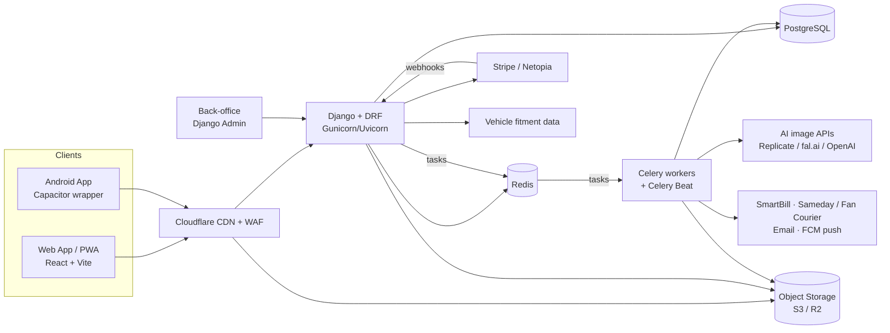
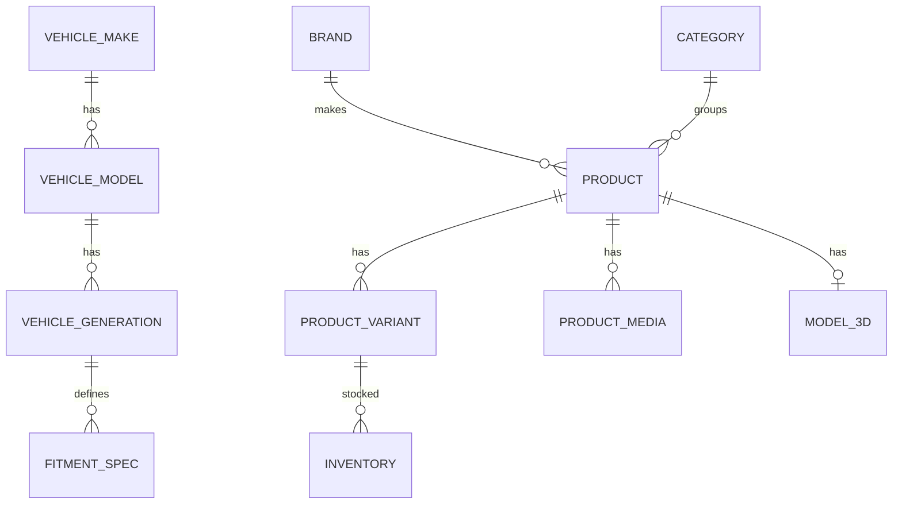
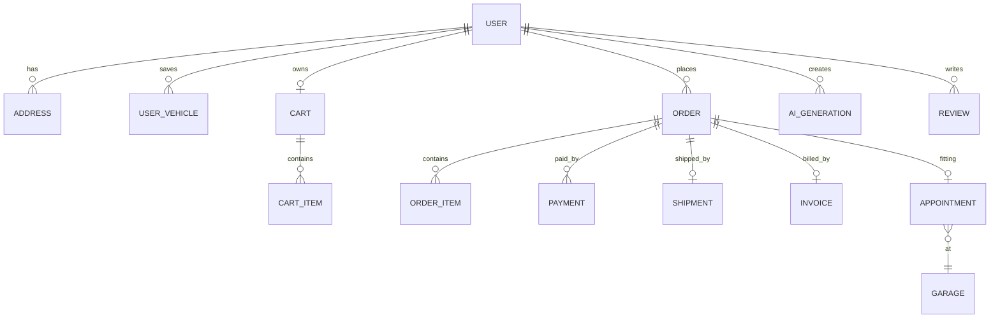
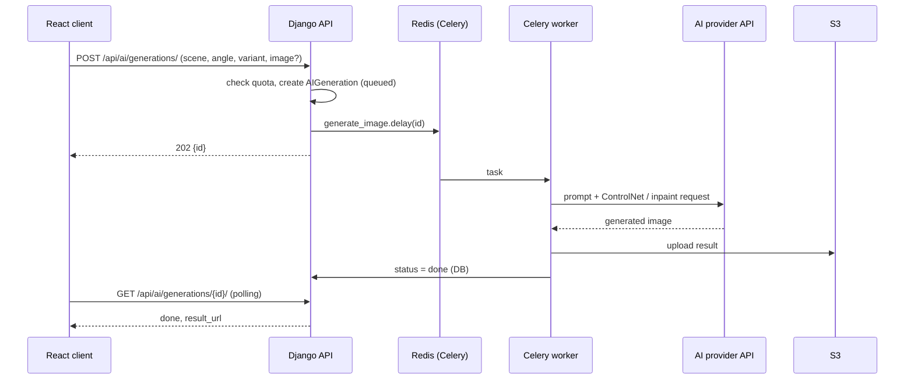
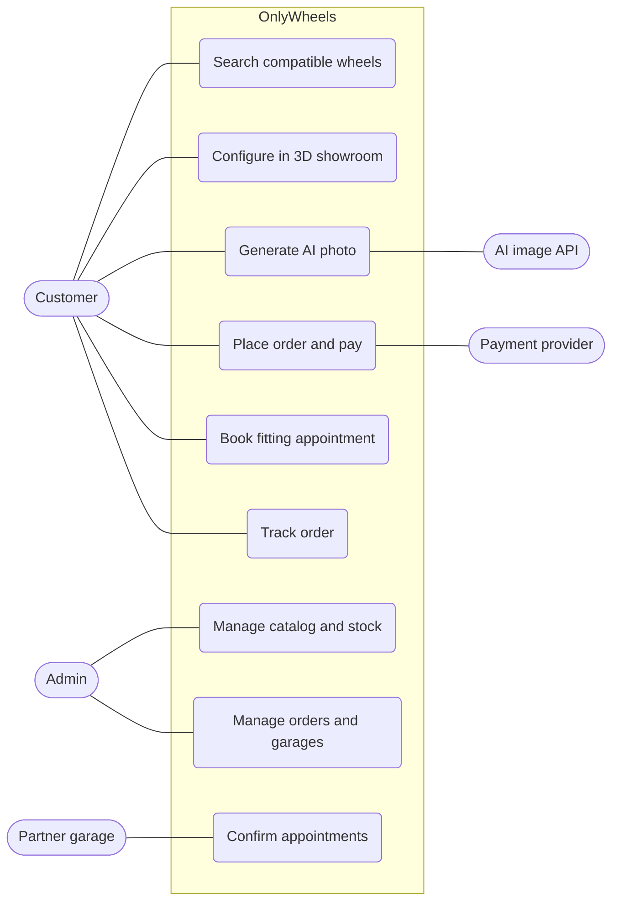

# OnlyWheels – System Architecture

> Online shop for wheels (jante), tires and complete wheel sets, with vehicle-fitment search,
> a 3D showroom/configurator, an AI photo studio, and fitting at partner garages.
> Strategy: **web-first (PWA)** → **Android app** from the same codebase via **Capacitor**.

**Homepage concept:** Open [index.html](../prototype/index.html) directly in a browser for a responsive,
Romanian-language desktop/mobile prototype. It includes vehicle selection, a searchable demo
catalog, session-only favorites/cart, an illustrative 2D showroom preview, local photo preview
and an explanation of partner fitting. All products, prices and stock are demonstration data.
No backend, fitment checks, real 3D rendering, AI generation, authentication, bookings or payments
are connected. The standalone HTML is a visual reference, not the React/PWA implementation.

> **Implementation status:** the MVP (phases 0–2 without 3D/AI) is implemented in `backend/` and `frontend/`.
> Where the implementation differs from the original plan below, the rows are marked **As built**;
> the full list of changes is in [§13 Implementation status](#13-implementation-status-as-built).
> Next steps: [ROADMAP.md](../ROADMAP.md).

---

## 1. Guiding principles

| Principle | Decision |
|---|---|
| Right tool per layer | **TypeScript** (JavaScript with types) **+ React** (UI library) on the frontend, **Python + Django** (web framework) on the backend |
| One codebase for web + Android | React **SPA** (single-page app – loads once, then updates without page reloads) / **PWA** (installable web app that can work offline), wrapped later with **Capacitor** (turns the web app into a native Android app) |
| Start simple, scale later | **Django monolith** (one backend application, deployed as a single unit) made of focused **Django apps** (self-contained modules, e.g. catalog, orders, payments) |
| Batteries included (the **framework** ships with most features built-in, so less code to write) | **Django ORM** (database access – work with tables as Python classes, no hand-written SQL), **migrations** (versioned, automatic database-structure changes), **auth** (user accounts, login, passwords, permissions) and **Django Admin** (ready-made admin web interface) as the **back-office** (internal panel for staff to manage products, orders, users) |
| Relational core data | **PostgreSQL** (relational database – data in linked tables) is the **source of truth** (the single authoritative place where data lives) |
| Async heavy work | **Celery** (background task runner) **+ Redis** (fast in-memory store, used as the task queue) for AI images, emails, invoices, courier **AWBs** (shipping labels / tracking numbers) – so users never wait for slow operations |
| AI as a service | Image generation through **external AI APIs** (paid online services called over the internet) – no **self-hosted models** or **GPUs** (no AI running on our own servers / graphics cards) |
| API contract first | **API** (the endpoints the app uses to talk to the backend) described by an **OpenAPI schema** (machine-readable description of every endpoint), generated by Django (**drf-spectacular**) → a **typed React client** (frontend code generated automatically from that schema, so frontend and backend always match) |

---

## 2. High-level overview



**Abbreviations**

- **PWA** – Progressive Web App: a website that can be installed on the phone and work partly offline.
- **CDN** – Content Delivery Network: servers close to users that deliver images, 3D models and app files faster.
- **WAF** – Web Application Firewall: blocks attacks and bot traffic before it reaches the server.
- **DRF** – Django REST Framework: builds the REST API (the URLs the React app calls to get/send data).
- **S3 / R2** – Cloud file storage (Amazon S3 / Cloudflare R2) for photos, 3D models and invoices.
- **FCM** – Firebase Cloud Messaging: sends push notifications to phones and browsers.
- **API** – Application Programming Interface: the endpoints through which apps and services talk to each other.

---

## 3. Technology stack

### 3.1 Frontend – customer app (web + Android)

| Concern | Technology |
|---|---|
| Framework | **React 19 + TypeScript** |
| Build tool | **Vite** |
| Routing | **As built:** **React Router 7** (data router) – chosen over TanStack Router for familiarity |
| Server state / data fetching | **TanStack Query** + client generated from Django's OpenAPI schema (**orval**). **As built:** `orval.config.ts` is ready; until it is run, each feature has a hand-written `api.ts` mirroring the serializers |
| Client state | **Zustand** (cart, configurator selections, UI) |
| Styling / UI kit | **Tailwind CSS** + **shadcn/ui** (Radix primitives) |
| Forms & validation | **React Hook Form** + **Zod** (Zod schemas can be generated from OpenAPI by orval) |
| 3D showroom | **Three.js** via **react-three-fiber** + **@react-three/drei**; models in **glTF/GLB** (Draco + KTX2 compressed) |
| AR (later) | WebXR on web; **ARCore** via Capacitor plugin on Android |
| i18n | **i18next** (ro default, en) |
| PWA | **vite-plugin-pwa** (Workbox) – installable, offline catalog cache. **As built:** manifest + icons, precached app shell, catalog API network-first, media cache-first, auto-update |
| Native wrapper | **Capacitor** (Android; iOS possible later) + plugins: Camera, Push Notifications, Share, Filesystem, Preferences |
| Analytics | **PostHog** (product analytics, feature flags). **As built:** not added |
| Errors | **Sentry**. **As built:** `@sentry/react`, loaded on demand only when `VITE_SENTRY_DSN` is set |

### 3.2 Back-office (admin)

| Concern | Technology |
|---|---|
| Admin UI | **Django Admin** with a modern theme (**django-unfold**) |
| Features | Products & variants, 3D/image upload, stock, prices/promotions, orders, refunds, partner garages & slots, users, reviews moderation, AI-job monitoring & quotas |
| Import/export | **django-import-export** (bulk CSV/Excel product & stock import from suppliers) |
| History / audit | **django-simple-history** (who changed prices/stock/orders) |

> A custom React admin is only needed later if partner garages get their own self-service portal.

### 3.3 Backend – API

| Concern | Technology |
|---|---|
| Language / runtime | **Python 3.12** |
| Framework | **Django 5.x** |
| REST API | **Django REST Framework (DRF)** |
| OpenAPI / docs | **drf-spectacular** (Swagger UI + schema for the React client) |
| ORM / migrations | Django ORM + built-in migrations (`django.contrib.postgres` for JSONB, arrays, full-text) |
| Filtering / pagination | **django-filter** + DRF **page-number** pagination (**As built:** chosen over cursor pagination so the UI can show "page X of Y") |
| Auth | **As built:** **djangorestframework-simplejwt** with our own endpoints (register, login, refresh, logout, me, password change/reset) – no django-allauth/dj-rest-auth (version conflicts). Google login = Google Identity Services ID token verified with `google-auth`. Access 15 min + rotating, blacklisted refresh (7 days); **argon2** hashing; login endpoints rate-limited |
| Token storage | httpOnly secure cookie on web (+ CSRF token header), `Authorization: Bearer` + `@capacitor/preferences`/secure storage on Android |
| Authorization | Groups/permissions: `customer`, `garage_partner`, `staff`, `admin` + DRF permission classes |
| Background jobs | **Celery** (workers) + **Celery Beat** (scheduled jobs) with **Redis** broker. **As built:** in development Celery runs tasks inline (`CELERY_TASK_ALWAYS_EAGER`), so Redis is not needed yet |
| Realtime updates | Polling for MVP → **Django Channels** (WebSocket) later for AI-job progress & order status |
| Caching / rate-limit | Redis via `django-redis` + DRF throttling. **As built:** local-memory cache in development; Redis when `CACHE_URL=rediscache://…` |
| File storage | **django-storages** (S3 / Cloudflare R2) – pre-signed URLs for direct uploads. **As built:** local `media/` folder by default; R2/S3 when `AWS_STORAGE_BUCKET_NAME` is set (uploads go through Django, no pre-signed URLs yet) |
| Images | **Pillow** + thumbnails via Cloudflare Images / imgproxy |
| Search | PostgreSQL search → **Meilisearch** when the catalog grows. **As built:** name/brand `icontains` + exact SKU; Meilisearch plan in `apps/catalog/search_index.py` |
| CORS / security | **django-cors-headers**, Django security middleware, CSP (`django-csp`). **As built:** CSP on Django pages when `CSP_ENABLED` (default in production); SPA CSP in `frontend/public/_headers` / nginx |
| Config | **django-environ** (12-factor `.env`) |
| Server | **Gunicorn** with Uvicorn workers (ASGI). **As built:** Gunicorn sync workers (WSGI) – nothing async yet; static files via **WhiteNoise** |
| Dependency management | **uv** (fast, lockfile) |
| Logging | **structlog** → Sentry / Grafana Loki. **As built:** structlog formatter for all Django logs, JSON in production; Sentry (`sentry-sdk`) when `SENTRY_DSN` is set |

### 3.4 AI photo studio (external APIs)

No models are run locally – Django calls hosted AI endpoints from Celery tasks.

| Concern | Choice |
|---|---|
| Providers | **Replicate** or **fal.ai** (SDXL / Flux + ControlNet + inpainting) – main choice for precise wheel swaps; **OpenAI Images** / **Stability AI API** as alternatives |
| Inputs | 3D-showroom render of the car with the chosen wheel, or the customer's own car photo + wheel mask |
| Abstraction | `ai_studio/providers/` – one small adapter per provider behind a common interface (`generate(scene, angle, style, image) → url`), switchable from settings |
| Execution | Celery task with retries + timeout; result stored in S3 |
| Cost control | Per-user daily quota / credits, usage log per generation, provider cost tracked |
| Security | API keys only on the server (env vars), never in React/Android |
| Safety | Provider moderation + optional watermark for free tier |

### 3.5 Data & storage

| Store | Usage |
|---|---|
| **PostgreSQL 16** | Users, vehicles, fitment, products, stock, carts, orders, payments, appointments, reviews, AI generations |
| **Redis 7** | Cache, Celery broker/results, rate limits, (later) Channels layer |
| **S3-compatible storage** (Cloudflare R2 / AWS S3; **MinIO** locally) | Product images, 3D models (GLB), AI-generated photos, invoices (PDF) |
| **Meilisearch** (phase 4) | Fast faceted catalog search (brand, size, PCD, finish, price) |

### 3.6 Third-party integrations (Romanian market)

| Domain | Provider |
|---|---|
| Card payments | **Stripe** (Python SDK) and/or **Netopia Payments** |
| Installments (0% rate) | Netopia / bank partner (e.g. TBI Bank, card-based installments) |
| Invoicing + e-Factura (ANAF) | **SmartBill API** (or Oblio) |
| Shipping / AWB | **Sameday**, **Fan Courier** APIs |
| Vehicle fitment data | **Wheel-Size API** (PCD, center bore, ET, OEM sizes) – synced into PostgreSQL by Celery Beat |
| Email | **django-anymail** + Resend / SendGrid |
| Push notifications | **Firebase Cloud Messaging** via **fcm-django** (Android + web push) |
| AI images | Replicate / fal.ai / OpenAI / Stability AI |
| Maps (partner garages) | Google Maps / Mapbox |

---

## 4. Repository structure (monorepo)

All code lives in one repository (**monorepo**) with two main parts – `frontend/` (React) and `backend/` (Django) –
plus shared infrastructure and CI/CD configuration.

```
onlywheels/
├── frontend/                # React + Vite PWA (pnpm)
│   ├── src/
│   │   ├── api/             # generated client (orval) + TanStack Query hooks
│   │   ├── features/        # home, catalog, showroom3d, ai-studio, cart, account
│   │   ├── components/      # shared UI (shadcn/ui)
│   │   └── lib/             # native adapters (camera, share, push, storage)
│   └── android/             # generated by Capacitor (phase 3)
├── backend/                 # Django project (uv)
│   ├── config/
│   ├── apps/
│   ├── tests/
│   └── pyproject.toml
├── infra/
│   ├── docker-compose.yml   # postgres, redis, minio, mailpit, (meilisearch)
│   └── nginx/               # reverse proxy config (prod)
├── .github/workflows/       # CI/CD
└── README.md
```

---

## 5. Backend structure (Django apps)

Zooming into the `backend/` folder from the repository above – the Django project is split into focused apps:

```
backend/
├── config/                  # settings (base/dev/prod), urls, asgi, wsgi, celery.py
└── apps/
    ├── accounts/            # custom User, profile, addresses, auth endpoints
    ├── vehicles/            # makes, models, generations, fitment specs, user's saved vehicles
    ├── catalog/             # brands, categories, products, variants, media, 3D models
    ├── fitment/             # "which wheels fit my car" compatibility engine
    ├── pricing/             # promotions, vouchers
    ├── inventory/           # stock per variant, reservations
    ├── cart/                # cart, sets of 4, fitting add-on
    ├── orders/              # checkout, orders, status history, VAT
    ├── payments/            # Stripe / Netopia, webhooks, installments
    ├── shipping/            # AWB generation, tracking               (phase 2: structure only)
    ├── invoicing/           # SmartBill, e-Factura                   (phase 2: structure only)
    ├── garages/             # partner garages, services, availability
    ├── appointments/        # fitting bookings
    ├── ai_studio/           # generations, gallery, quotas, providers/ (phase 2: structure only)
    ├── reviews/             # ratings & reviews, favorites
    ├── notifications/       # email (built), push (phase 3 stub)
    └── core/                # base models (UUID, timestamps), utils, permissions
```

**As built:** there is no separate `search/` app – search lives in `catalog` (`filters.py`, `search_index.py`).

Each app owns its models, `serializers.py`, `views.py` (DRF ViewSets), `services.py` (business logic),
`tasks.py` (Celery) and `admin.py`. Apps communicate through services and Django signals, not through each other's internals.

---

## 6. Data model (core entities)

**Vehicles & catalog**



**Users, carts & orders**



Cross-links: `USER_VEHICLE → VEHICLE_GENERATION`, `CART_ITEM / ORDER_ITEM → PRODUCT_VARIANT`, `REVIEW → PRODUCT`.

Key fields:

| Model | Important fields |
|---|---|
| `FitmentSpec` | **As built:** `generation (1:1), pcd (normalized, e.g. 5x114.3), center_bore_mm, et_min/et_max, diameter_min/max, width_min/max, thread_size, tire_sizes (JSON list of OEM sizes)` |
| `Product` | `type (wheel/tire/set/accessory), brand, category, name, slug, style, description, badge, is_featured, rating_avg, rating_count` |
| `ProductVariant` | `sku, price, old_price, finish, diameter_in, width_in, et_mm, pcd, center_bore_mm, tire_width_mm, tire_aspect, load_index, speed_rating, season, tire_size (computed), thread_size, label` |
| `StockItem` | `variant (1:1), quantity, reserved` |
| `Model3D` | `glb_file, thumbnail, finish_materials (JSONField)` – **As built:** model + admin inline + `model_3d` in the product API; the 3D viewer itself is phase 2 |
| `Order` | `number, status, delivery_method (courier/garage_fitting), contact + address snapshot, subtotal, discount, voucher, shipping, fitting, total, vat, reserved_until, paid_at` (installments: later) |
| `Payment` | `order, provider (fake/stripe), session_id, amount, status, payment_reference` |
| `Appointment` | `garage, order (1:1), slot_start, slot_end, status (held/booked/confirmed/completed/cancelled)` |
| `Voucher` | `code, kind (percent/fixed), value, min_order_total, valid_from/until, max_uses, used_count` |
| `Review` | `product, user, rating 1–5, title, body, status (pending/approved/rejected), is_verified_purchase` |
| `AIGeneration` | `user, provider, source (3d_render/user_photo), scene, angle, style, status, result_image, cost` (model only) |

Conventions: money as `DecimalField(max_digits=10, decimal_places=2)` in RON; `DateTimeField` with `USE_TZ=True`;
primary keys as **UUID**; custom `User` model from day one.

---

## 7. Key flows

### 7.1 "Find wheels that fit my car"
1. User picks make → model → generation (or a saved vehicle).
2. **As built:** `GET /api/v1/catalog/products/?vehicle=<generation_id>&…filters` keeps only variants with the same
   **PCD**, a **center bore ≥ the car's hub** (larger = fits with hub-centric rings), **ET**, **diameter** and **width**
   inside the generation's range; tires must be an OEM size; all filters apply to the same variant.
   `GET /api/v1/catalog/products/<slug>/?vehicle=<id>` returns fits / fits with rings / reasons per variant.
3. Caching per generation + filter hash in Redis: later (not needed at demo scale).

### 7.2 3D configurator
1. Frontend loads the car GLB plus the wheel GLB from the CDN (lazy, Draco-compressed).
2. Finish/size changes only swap materials and scale on the client, with no backend calls.
3. "Add to cart" sends the selected `variant_id` × 4.

### 7.3 AI photo studio


### 7.4 Checkout & payment
1. Cart → checkout (address, shipping or **fitting at partner garage** + slot).
2. Order is created as `pending_payment`, stock is **reserved** and the garage slot **held** for **30 min**
   (**As built:** 30 instead of 15 because a Stripe Checkout session lasts at least 30 min). Expired orders are
   cancelled by Celery Beat every 5 min and also whenever a new order is placed.
3. Redirect to the payment page: **Stripe Checkout** (test mode) or, in development, a **simulated payment page**
   (`PAYMENT_PROVIDER=fake`, refused in production). Netopia + installments: phase 2.
4. Payment **webhook** (signature-checked, idempotent, amount-checked) → `paid` → stock deducted, slot booked,
   voucher counted, confirmation email + garage email. Invoice (SmartBill), AWB (courier) and push: phase 2/3.

---

## 8. Requirements

### 8.1 Functional requirements

| ID | The user can… |
|---|---|
| FR1 | Register / log in (email or Google) and save their car(s) |
| FR2 | Search wheels **compatible with their car** (PCD, center bore, ET, size) |
| FR3 | Browse and filter the catalog (brand, size, finish, price) and view product details |
| FR4 | Preview wheels on the car in the **3D showroom** (change model, size, finish) |
| FR5 | Generate **AI photos** of their car with the selected wheels |
| FR6 | Add sets of 4 to the cart, pay online (card / installments) and track the order |
| FR7 | Book **fitting at a partner garage** during checkout |
| FR8 | Admin manages products, stock, prices, orders, garages and users |
| FR9 | Partner garage sees and confirms its fitting appointments |

### 8.2 Non-functional requirements

| Category | Requirement | Addressed by |
|---|---|---|
| Performance | Pages load in < 2 s on mobile; API responses < 300 ms | CDN, Redis cache, compressed 3D models |
| Responsiveness | Slow tasks (AI images, invoices) never block the user | Celery background jobs |
| Security | Encrypted traffic, safe passwords, protected payments | HTTPS, JWT, argon2, WAF, hosted payment page |
| Availability | ≥ 99.5% uptime, daily backups | Managed PostgreSQL, monitoring (Sentry), backups |
| Scalability | Handle traffic peaks (e.g. tire-change season) | Stateless API, more workers/containers on demand |
| Portability | Same app on web and Android | React PWA + Capacitor |
| Usability | Mobile-first, Romanian & English | Responsive UI, i18next |
| Compliance | GDPR, Romanian e-Factura | EU data hosting, SmartBill integration |

---

## 9. Actors and use cases

| Actor | Description |
|---|---|
| **Customer** | Visitor or registered user who searches, configures and buys wheels |
| **Admin** | OnlyWheels staff managing catalog, orders and partners (via Django Admin) |
| **Partner garage** | Service that mounts the wheels and manages fitting appointments |
| **External systems** | Payment provider, AI image API, courier, invoicing (SmartBill) |



---

## 10. Infrastructure & DevOps

| Concern | Choice |
|---|---|
| Local dev | **Docker Compose**: PostgreSQL, Redis, MinIO, Mailpit; Django `runserver` + Vite dev server. **As built:** compose file has PostgreSQL only (optional – native PostgreSQL or Supabase also work); emails print to the console; no Redis/MinIO needed yet |
| Containers | Dockerfiles: `backend` (Django/Gunicorn), `worker` (Celery), `beat` (Celery Beat) – same image, different command. **As built:** `infra/docker/backend.Dockerfile` (web/worker/beat), `infra/docker/frontend.Dockerfile` (SPA build + nginx), `infra/docker-compose.prod.yml` (+ PostgreSQL, Redis) – written, not yet run |
| Hosting (MVP, low cost) | **Hetzner / DigitalOcean** VM with Docker + **Coolify**, or **Railway / Render** |
| Hosting (scale) | **AWS**: ECS Fargate (web/worker), RDS PostgreSQL, ElastiCache Redis, S3 + CloudFront |
| Frontend hosting | **Cloudflare Pages** / Vercel (static SPA + PWA) |
| Static files (admin) | **WhiteNoise** or S3. **As built:** WhiteNoise (compressed, hashed) |
| CDN / WAF / DNS | **Cloudflare** |
| CI/CD | **GitHub Actions**: ruff + mypy + pytest (backend), eslint + tsc + vitest (frontend) → build images → `migrate` → deploy; Android build with Gradle → Play Console (internal track). **As built:** `.github/workflows/ci.yml` – ruff, migrations check, OpenAPI check, pytest on PostgreSQL; tsc, eslint, vitest, build; Docker image build. No mypy, no deploy job yet |
| Secrets | GitHub Environments + cloud secret manager; never in repo |
| Backups | Daily PostgreSQL dumps + PITR (managed DB), S3 versioning |
| Monitoring | **Sentry** (React + Django + Celery), **Flower** (Celery dashboard), Grafana/Loki or Better Stack, uptime checks |

Environments: `local` → `staging` → `production`.

---

## 11. Web → Android path

1. Build a **responsive, mobile-first PWA** (bottom tab nav like the demo: Home, Catalog, Showroom 3D, AI Studio, Cart).
2. Keep native-dependent code behind small adapters (`camera`, `share`, `push`, `storage`) so the web version uses Web APIs and Android uses Capacitor plugins.
3. `npx cap add android` → configure deep links, splash/icons, FCM, ARCore plugin.
4. Use JWT storage via `@capacitor/preferences` / secure-storage instead of cookies on native; Django API is unchanged.
5. Publish via the Play Console. A **TWA** (Bubblewrap) is a lighter alternative if no native features are needed.

---

## 12. Roadmap

| Phase | Scope |
|---|---|
| **0 – Foundation** | Repo, Docker Compose, CI, Django project + custom User, JWT auth, React app shell + design system |
| **1 – MVP shop** | Vehicle fitment search, catalog + filters, product page, cart (sets of 4), checkout with Stripe/Netopia, orders, Django Admin back-office, emails |
| **2 – Experience** | 3D showroom configurator, AI studio (external APIs), reviews, favorites, partner garages + appointments, SmartBill + courier integration, PWA offline |
| **3 – Android** | Capacitor app, push notifications, camera upload for AI studio, Play Store release |
| **4 – Scale** | Meilisearch, Django Channels realtime, AR (ARCore/WebXR), installments, recommendations, garage partner portal, iOS |

---

## 13. Implementation status (as built)

State of the code in the repository. Tested in an isolated environment (SQLite, 147 backend + 34 frontend
tests, browser end-to-end flow); first run on PostgreSQL happens on the development machine – see [SETUP.md](../SETUP.md).

| Roadmap item | Status |
|---|---|
| Phase 0 – Foundation | ✅ Django project, custom User, JWT cookie auth, Google login, password reset, React shell + design system, i18n ro/en, Dockerfiles + production compose, GitHub Actions CI (both written, not yet executed) |
| Phase 1 – MVP shop | ✅ Fitment search, catalog + filters, product page, cart (guest + account), checkout, vouchers, orders, admin, emails. Stripe test mode + simulated payment. GDPR data export + account deletion. ❌ Netopia |
| Phase 2 – Experience | ✅ Reviews (moderated), favorites, partner garages + appointment slots, PWA (installable, offline catalog), `Model3D` data model. 🧱 Structure only: AI studio, SmartBill, courier AWB. ❌ 3D viewer page |
| Phase 3 – Android | 🧱 Native adapters (`frontend/src/lib/native/`), Bearer-token auth and `capacitor.config.json` ready. ❌ Android project (`npx cap add android`) |
| Phase 4 – Scale | 🧱 Meilisearch plan (`catalog/search_index.py`). ❌ rest |
| Operations | ✅ Sentry (Django, Celery, React), structlog JSON logs, CSP, WhiteNoise, R2/S3 storage, Redis cache, Resend email – each switched on by environment variables ([SETUP.md §9](../SETUP.md)) |

✅ implemented · 🧱 models/interfaces + design notes in code, raises `NotImplementedError` · ❌ not started

Not prepared at all (only described in this document): Apple login, maps for the garage list, Wheel-Size API,
Django Channels (realtime), PostHog analytics, Flower, mypy.

### Decisions that changed during implementation

| Topic | Plan | As built | Why |
|---|---|---|---|
| Login | django-allauth + simplejwt | simplejwt + own endpoints, Google ID token via `google-auth` | allauth/dj-rest-auth API churn; fewer moving parts |
| Routing | TanStack Router or React Router | React Router 7 | Team familiarity, more tutorials |
| Pagination | Cursor | Page number | UI shows "page X of Y" |
| Stock reservation | 15 min | 30 min | Minimum Stripe Checkout session length |
| Payments in dev | Stripe test | Simulated provider by default + Stripe test | Demo without any account; production refuses `fake` |
| Background jobs (dev) | Celery + Redis | Celery in eager mode | No Docker/Redis on dev machines yet |
| Fitment data | Wheel-Size API | 13 hand-curated demo generations (`seed_demo`) | No free dataset; API is paid |
| Fitment storage | `oem_sizes` ArrayField | `tire_sizes` JSONField + diameter/width ranges | Simpler admin editing, range checks |
| Search | PostgreSQL full-text + trigram | `icontains` on name/brand + exact SKU | Enough for the demo catalog |
| API client | orval-generated | Hand-written `api.ts` per feature, orval config ready | Client can only be generated with the backend running |
| Guest cart | Server cart | Browser cart for guests, merged into the server cart on login | No anonymous sessions in the API |
| Garage partner portal | Later React portal | Django Admin restricted to the partner's garages | Covers FR9 with no extra UI |
| App server | Gunicorn + Uvicorn workers (ASGI) | Gunicorn sync workers (WSGI) | No async views or WebSockets yet |
| Production hosting | Coolify / Render | Two documented options: Docker Compose on one server, or Cloudflare Pages + hosted API | Cheapest for a demo; no extra platform to learn |
| GDPR erasure | — | Anonymise the user, keep orders | Romanian accounting law requires keeping invoices/orders |

Future steps, known limitations and the first-run checklist: [ROADMAP.md](../ROADMAP.md).
